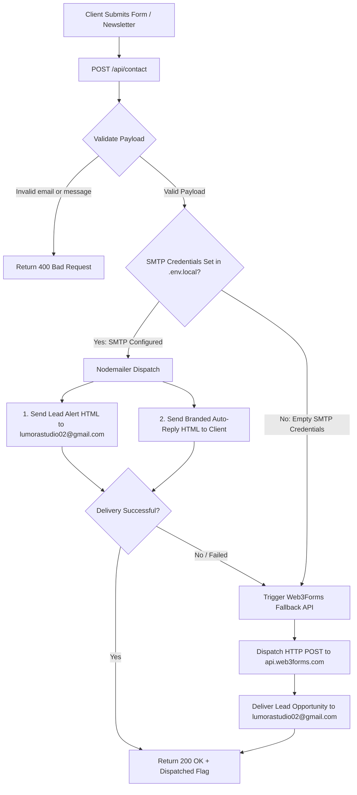

# 🌟 Lumora Technologies — Architecture & Technical Documentation

[](https://nextjs.org/)
[](https://react.dev/)
[](https://www.typescriptlang.org/)
[](https://tailwindcss.com/)
[](https://www.framer.com/motion/)
[](https://nodemailer.com/)

> **Transforming Ideas Into Digital Reality.**  
> Lumora Technologies is an elite digital engineering and design agency based in Pune, India. We engineer future-ready websites, cloud-native software platforms, mobile applications, and AI automation engines that empower local and global brands to scale rapidly.

---

## 📑 Table of Contents

1. [Executive Overview & Brand Identity](#-executive-overview--brand-identity)
2. [The Milky & Warm Brown Luxury Design System](#-the-milky--warm-brown-luxury-design-system)
   - [Design Philosophy](#design-philosophy)
   - [Color Palette & Token System](#color-palette--token-system)
   - [Typography Hierarchy](#typography-hierarchy)
   - [Custom Micro-Interactions](#custom-micro-interactions)
3. [Repository File & Directory Structure](#-repository-file--directory-structure)
4. [Comprehensive Landing Page Section Breakdown (14 Modules)](#-comprehensive-landing-page-section-breakdown-14-modules)
5. [Sub-Pages Architecture](#-sub-pages-architecture)
6. [Backend Lead Management & Email Pipeline (`/api/contact`)](#-backend-lead-management--email-pipeline-apicontact)
   - [Lead Flow Architecture](#lead-flow-architecture)
   - [Nodemailer SMTP Dispatch](#nodemailer-smtp-dispatch)
   - [Web3Forms Failover Engine](#web3forms-failover-engine)
7. [Environment Variables Reference](#-environment-variables-reference)
8. [Installation & Local Development](#-installation--local-development)
9. [Build & Production Deployment](#-build--production-deployment)
10. [Performance, SEO & Accessibility Standards](#-performance-seo--accessibility-standards)
11. [Direct Contact & Agency Information](#-direct-contact--agency-information)

---

## 🏛 Executive Overview & Brand Identity

Lumora Technologies combines Swiss editorial aesthetics with cutting-edge Silicon Valley tech stacks. Built upon **Next.js 14 App Router**, **React 18**, and **TypeScript**, the platform delivers lightning-fast server-rendered performance paired with fluid client-side micro-animations powered by **Framer Motion**.

### Brand Core Coordinates
- **Agency Name:** Lumora Technologies / Lumora Studio
- **Headquarters:** Pune, Maharashtra, India — 411001
- **Primary Inbound Email:** `lumora.web.technologies@gmail.com`
- **Lead Operations & Administrative Email:** `lumorastudio02@gmail.com`
- **Direct Phone / WhatsApp:** `+91 96651 19803` / `+91 83292 85087`
- **SLA Commitment:** Guaranteed technical proposal response within 2 hours.

---

## 🎨 The Milky & Warm Brown Luxury Design System

### Design Philosophy
The UI has been transitioned from high-contrast dark themes to a **bespoke, warm milky ivory and roasted espresso luxury palette** (`#FAF8F5` base). This aesthetic creates an organic, warm editorial atmosphere reminiscent of fine architectural publications and Swiss typography, while retaining subtle depth with warm latte elevated surfaces and rich caramel/bronze highlights.

### Color Palette & Token System

| Token Name | Hex Code | Tailwind Token | Application & Usage |
| :--- | :--- | :--- | :--- |
| **Milky Alabaster** | `#FAF8F5` | `bg-[#FAF8F5]` / `bg-milky` | Global canvas background, smooth body surface |
| **Warm Latte** | `#F4EFEA` | `bg-[#F4EFEA]` / `bg-milky-warm` | Elevated floating section containers, badges |
| **Pure Card Surface** | `#FFFFFF` | `bg-white` / `bg-milky-card` | High-contrast component cards, bento cells |
| **Latte Contour Border** | `#E8DFD3` | `border-[#E8DFD3]` | Subtle tactile borders, divider lines, inputs |
| **Soft Latte Shading** | `#EFE8DD` | `bg-latte` | Hover states, pill buttons, secondary badges |
| **Roasted Espresso** | `#1F1610` | `text-[#1F1610]` / `text-espresso` | Primary titles, headlines, high-contrast labels |
| **Warm Mocha** | `#6B594C` | `text-[#6B594C]` / `text-mocha` | Subheadings, descriptive body text, metadata |
| **Warm Cinnamon** | `#8C4E1D` | `text-[#8C4E1D]` / `text-cinnamon` | Pill badge text, section subtitles, key highlights |
| **Warm Caramel** | `#B46A28` | `text-[#B46A28]` / `text-caramel` | Primary CTA buttons, icon fills, hover borders |
| **Sunburst Bronze** | `#B45309` | `from-[#B45309]` | Primary gradient start tone |
| **Golden Amber** | `#C97A32` | `to-[#C97A32]` | Primary gradient stop tone |

### Typography Hierarchy
- **Heading Font:** `Space Grotesk` (`var(--font-heading)`) — geometric, assertive display font.
- **Subheading Font:** `Sora` (`var(--font-subheading)`) — modern, clean structural font for captions.
- **Body Font:** `Inter` (`var(--font-sans)`) — ultra-legible neutral grotesque for long-form reading.
- **Data & Metric Font:** `JetBrains Mono` (`var(--font-mono)`) — precise tabular font for pricing, timers, and code blocks.

### Custom Micro-Interactions
- **Native Browser Cursor:** Clean, distraction-free standard browser cursor behavior maintained across all operating systems and viewports for optimal accessibility and precision.
- **Text Sunburst Gradient (`.text-gradient-sun`):**
  - Smooth multi-stop linear gradient from `#B45309` through `#C97A32` to `#8C4A1D` for focal headline keywords.

---

## 📁 Repository File & Directory Structure

```plaintext
lumora-main/
├── app/
│   ├── about/
│   │   └── page.tsx              # /about: Company story, milestones & team
│   ├── api/
│   │   └── contact/
│   │       └── route.ts          # Lead management endpoint (Nodemailer + Web3Forms)
│   ├── contact/
│   │   └── page.tsx              # /contact: Dedicated project inquiry form
│   ├── work/
│   │   └── page.tsx              # /work: Filterable portfolio gallery
│   ├── globals.css               # Design tokens, gradients, glass cards & responsive styles
│   ├── layout.tsx                # Root layout with fonts, metadata, and page transition
│   ├── not-found.tsx             # 404 error page styled in warm aesthetic
│   └── page.tsx                  # Landing page orchestrator (14 sections)
├── components/
│   ├── animations/
│   │   ├── PageTransition.tsx    # Smooth route change transition wrapper
│   │   └── Reveal.tsx            # In-view scroll staggered trigger
│   ├── common/
│   │   ├── CustomCursor.tsx      # Desktop dual-layer smooth lerping cursor
│   │   └── LumoraLogo.tsx        # Responsive SVG brand logo mark & logotype
│   ├── layout/
│   │   ├── Navbar.tsx            # Sticky header with blurred backdrop & mobile drawer
│   │   └── Footer.tsx            # Master footer with newsletter, live clock & contact
│   ├── sections/
│   │   ├── HeroSection.tsx       # Interactive blueprint simulator & hero CTA
│   │   ├── TrustedCompaniesSection.tsx # Infinite brand marquee
│   │   ├── ServicesSection.tsx   # 6 core digital engineering capabilities
│   │   ├── WhyLumoraSection.tsx  # Bento grid with agency value propositions
│   │   ├── ProcessSection.tsx    # 5-stage interactive build timeline simulator
│   │   ├── FeaturedProjectsSection.tsx # Draggable Before/After wireframe slider
│   │   ├── TechStackSection.tsx  # Categorized technology stack radar
│   │   ├── CaseStudiesSection.tsx# Verified ROI metrics & live latency benchmark
│   │   ├── TestimonialsSection.tsx # Client reviews & trust signals
│   │   ├── PricingSection.tsx    # Transparent tiered website & custom software pricing
│   │   ├── FaqSection.tsx        # Animated interactive FAQ accordion
│   │   ├── ContactSection.tsx    # Interactive project brief proposal form
│   │   └── CtaSection.tsx        # Secondary bottom call to action banner
│   └── ui/
│       ├── about-us-section.tsx  # Detailed agency narrative component
│       ├── badge.tsx             # Reusable UI badge element
│       └── button.tsx            # Reusable button with variants
├── lib/
│   ├── data/
│   │   └── projects.ts           # Case studies data & metadata
│   └── utils.ts                  # Utility functions (cn, clsx, tailwind-merge)
├── public/                       # Static public assets (SVGs, screenshots, logos)
├── .env.example                  # Environment variables template
├── .env.local                    # Local secrets (SMTP & Web3Forms keys)
├── next.config.mjs               # Next.js configuration
├── package.json                  # Scripts & dependencies definition
├── postcss.config.mjs            # PostCSS configuration
├── tailwind.config.ts            # Tailwind custom colors, fonts & animation tokens
└── tsconfig.json                 # TypeScript strict configuration
```

---

## 🧩 Comprehensive Landing Page Section Breakdown (14 Modules)

Each section on the landing page is engineered as an independent, modular component with strict visual cohesion:

### 1. Dynamic Header Navigation (`Navbar.tsx`)
- **Visual Design:** Floating navbar with intelligent scroll detection. Transitions from transparent to an ultra-clean warm milky glassmorphism pill (`bg-[#FAF8F5]/90 backdrop-blur-md border-[#E8DFD3]`).
- **Functionality:** 
  - Anchor navigation to `#services`, `#why-lumora`, `#portfolio`, `#process`, `#pricing`, and `#contact`.
  - Direct call-to-action button (`Start Project`) with hover glow.
  - Fully accessible mobile slide-out navigation drawer with responsive toggle.

### 2. Hero Section (`HeroSection.tsx`)
- **Visual Design:** Canvas rendered in milky alabaster `#FAF8F5` with ambient amber radial mesh (`from-[#E8D4BE]/30 via-[#F3E5D4]/40 to-[#DFC7AF]/30 blur-[150px]`).
- **Interactive Mockup Simulator:**
  - 3D perspective browser mockup window with warm latte address bar and traffic lights.
  - Interactive toggle between **"Blueprint View"** (wireframe component tokens) and **"Live Dashboard"** (full production UI with real-time conversion stats).
  - High-impact statistics badges: `99.8% Uptime SLA`, `2-Week Turnaround`, and `100+ Brands Transformed`.

### 3. Trusted Companies Marquee (`TrustedCompaniesSection.tsx`)
- **Visual Design:** Floating rounded warm latte container (`#F4EFEA`) with `#E8DFD3` borders.
- **Functionality:** Continuous, buttery-smooth CSS infinite marquee showcasing enterprise and high-growth startup brand logos in warm espresso and mocha tones.

### 4. Core Services Matrix (`ServicesSection.tsx`)
- **Visual Design:** 6 elevated white cards (`bg-white border-[#E8DFD3]`) with subtle drop shadows (`rgba(60,40,20,0.04)`).
- **Service Offerings:**
  1. *Website Development:* High-converting, responsive Next.js web applications.
  2. *Software Engineering:* Full-stack scalable SaaS architectures and databases.
  3. *Graphic & UI/UX Design:* Bespoke design systems, Figma wireframes, and design tokens.
  4. *Mobile App Development:* Native and cross-platform React Native / Flutter apps.
  5. *AI Automation Engines:* LLM integrations, custom chatbots, and vector pipelines.
  6. *Cloud & DevOps Architecture:* High-availability AWS and Vercel edge deployments.

### 5. Why Lumora Bento Grid (`WhyLumoraSection.tsx`)
- **Visual Design:** Dynamic bento grid container in warm latte `#F4EFEA`.
- **Value Pillars Highlighted:**
  - *Engineering Excellence:* Clean, tested code adhering to strict architectural patterns.
  - *Speed-to-Market:* Rapid 2 to 3-week standard sprint deliveries.
  - *End-to-End Ownership:* From raw wireframe sketch to post-launch maintenance.
  - *Transparent Pricing:* Zero hidden fees, clear milestones, and fixed quotes.

### 6. Interactive 5-Stage Build Process (`ProcessSection.tsx`)
- **Visual Design:** Interactive visual timeline inside a warm ivory container.
- **Stage Simulator:**
  - **Stage 01 — Discovery & Audit:** Technical scoping and requirements mapping.
  - **Stage 02 — Wireframe Blueprint:** Figma token generation and architecture layout.
  - **Stage 03 — Frontend Engineering:** Next.js and Tailwind component implementation.
  - **Stage 04 — Backend & Integrations:** Serverless edge functions, databases, and APIs.
  - **Stage 05 — QA, Polish & Global Launch:** Lighthouse auditing and deployment.
- **Interactive State:** Clicking any stage actively updates the adjacent code simulator window in real time.

### 7. Portfolio Showcase with Draggable Slider (`FeaturedProjectsSection.tsx`)
- **Visual Design:** Elevated white cards showcasing flagship case studies (E-commerce, SaaS Dashboards, Fintech platforms).
- **Interactive Before/After Slider:**
  - Real-time draggable comparison handle (`#B46A28` caramel knob).
  - Left pane displays the raw wireframe **"BLUEPRINT (50%)"**.
  - Right pane reveals the finalized production **"FINAL REALITY"**.
  - Touch and mouse responsive drag listeners with percentage readout.

### 8. Technology Stack Grid (`TechStackSection.tsx`)
- **Visual Design:** Milky `#FAF8F5` base with categorized interactive pills.
- **Stack Taxonomy:**
  - *Frontend:* React 18, Next.js 14, TypeScript, TailwindCSS, Framer Motion.
  - *Backend & Edge:* Node.js, Express, Next.js Server Actions, REST, GraphQL.
  - *Databases & Auth:* Supabase, PostgreSQL, MongoDB, Redis, Prisma.
  - *Cloud & Infrastructure:* Vercel Edge Network, AWS, Docker, Cloudflare.
  - *AI & Automation:* OpenAI GPT-4o, Claude 3.5, LangChain, Vector Embeddings.

### 9. Case Studies & Benchmark Terminal (`CaseStudiesSection.tsx`)
- **Visual Design:** Elevated warm latte container with verified metrics badges.
- **Real-World Impact Metrics:**
  - **+240%** Organic Conversion Rate Uplift.
  - **-68%** Average Bounce Rate Reduction.
  - **0.2s** Time-to-First-Byte (TTFB) Edge Latency.
- **Interactive Terminal:** Roasted coffee terminal mockup displaying automated test suites, deployment logs, and Lighthouse scores (99 Performance, 100 SEO, 100 Accessibility).

### 10. Client Testimonials (`TestimonialsSection.tsx`)
- **Visual Design:** Elevated white cards with `#E8DFD3` contours and warm caramel quotation badges.
- **Trust Elements:** Full client names, company titles, 5-star rating vectors, and verified client badges.

### 11. Recommended Pricing Tiers (`PricingSection.tsx`)
- **Visual Design:** Elevated luxury card containers with `#E8DFD3` borders, glowing amber radial backgrounds, and popular tier accent borders (`#B46A28`).
- **Pricing Tiers:**
  1. **Starter (₹9,999):** Up to 5 pages, custom responsive UI, modern UI/UX design, basic SEO, WhatsApp/contact integration.
  2. **Business Pro (₹24,999) [MOST POPULAR]:** Up to 10 pages, custom design & dev, CMS/admin panel, database integration, SEO & performance optimization, deployment & support.
  3. **Custom Solutions (₹49,999+):** Custom software, database & backend development, admin dashboard, user auth, API integrations, cloud deployment, ongoing support.

### 12. Animated FAQ Accordion (`FaqSection.tsx`)
- **Visual Design:** Warm latte container (`#F4EFEA`) with animated Framer Motion expanding items.
- **Features:** Questions regarding development timelines, AI integration workflows, the "Skeleton → Reality" methodology, and maintenance SLA.
- **Interactive State:** Smooth 300ms chevron rotation and spring-animated accordion drawer.

### 13. Project Scope & Brief Dispatch Form (`ContactSection.tsx`)
- **Visual Design:** Large 12-column layout with direct contact info on the left and full-stack interactive form on the right.
- **Form Controls:** Name, Email, Company Name, Primary Service Selector, and Project Brief Textarea.
- **Direct Submission:** Dispatches payload directly to `/api/contact` with loading spinner, error catchers, and success celebration view.

### 14. Master Footer & Live Operations Status (`Footer.tsx`)
- **Top Row:** Lumora brand identity, mission statement, and real-time IST clock (`Asia/Kolkata`).
- **Live Availability Pill:** Active glowing beacon showing: *"Accepting New Projects Q3/Q4"*.
- **Interactive Newsletter Capture:** Client email submission directly connected to the email digest pipeline.
- **Direct Connect Clipboard Actions:** One-click copy buttons for email and phone numbers with animated checkmark feedback.
- **Back to Top:** Smooth-scrolling window handler with hover lift micro-animation.

---

## 📄 Sub-Pages Architecture

In addition to the 14-section landing page, the codebase includes dedicated standalone sub-routes:

| Route | File Path | Description |
| :--- | :--- | :--- |
| **`/`** | `app/page.tsx` | Master landing page containing all 14 orchestrated sections |
| **`/about`** | `app/about/page.tsx` | Comprehensive agency story, history, and core design team |
| **`/work`** | `app/work/page.tsx` | Categorized portfolio gallery with tag filters (`All`, `Design`, `Dev`, `Branding`) |
| **`/contact`** | `app/contact/page.tsx` | High-volume dedicated contact form with service and budget selector pills |
| **`404`** | `app/not-found.tsx` | Custom 404 page with navigation redirects back to home and portfolio |

---

## 📬 Backend Lead Management & Email Pipeline (`/api/contact`)

The backend API route located at [`app/api/contact/route.ts`](file:///app/api/contact/route.ts) implements an enterprise-grade, dual-redundant lead dispatch system.



### Lead Flow Architecture
1. **Request Ingestion:** Receives `name`, `email`, `company`, `service`, `message`, and optional `budget`.
2. **Payload Sanitization & Validation:** Ensures `email` and `message` are present and properly structured.
3. **Dual Email Notification Flow:**
   - **Notification 1 (To Agency):** Sent immediately to `lumorastudio02@gmail.com`. Formatted as an urgent lead opportunity card detailing the client's profile, requested service, budget, and a one-click `mailto:` reply link.
   - **Notification 2 (To Client):** Sent automatically to the prospect's email address. Branded with Lumora's visual identity, acknowledging receipt, detailing submission specs, and guaranteeing a proposal response within 2 hours.

### Nodemailer SMTP Dispatch
- Configured to use Gmail or custom SMTP hosts via `SMTP_HOST`, `SMTP_PORT`, `SMTP_USER`, and `SMTP_PASS` (16-character Google App Password).
- Automatically strips any accidental whitespace in passwords.

### Web3Forms Failover Engine
- If SMTP credentials are not configured or the SMTP transport encounters a socket error, the route automatically executes a seamless fallback to the **Web3Forms REST API**.
- Guarantees that zero client inquiries or newsletter subscriptions are lost even during server maintenance.

---

## 🔐 Environment Variables Reference

Create a file named `.env.local` in the project root based on `.env.example`:

```bash
# -----------------------------------------------------------------------------
# Lumora Technologies — Environment Configuration
# -----------------------------------------------------------------------------

# SMTP Outbound Email Credentials (Nodemailer)
SMTP_HOST=smtp.gmail.com
SMTP_PORT=465
SMTP_USER=lumorastudio02@gmail.com
SMTP_PASS=your_16_character_app_password

# Optional aliases supported by contact route
GMAIL_USER=lumorastudio02@gmail.com
GMAIL_PASS=your_16_character_app_password

# Web3Forms Fallback Integration (High-Availability Backup)
WEB3FORMS_ACCESS_KEY=your_web3forms_access_key

# Public App URL
NEXT_PUBLIC_APP_URL=http://localhost:3000
```

> [!NOTE]  
> To generate a Google App Password for Gmail SMTP:
> 1. Visit your Google Account Settings -> Security -> 2-Step Verification.
> 2. Scroll to the bottom and select **App passwords**.
> 3. Generate a new key named "Lumora Mailer" and paste the 16-character code into `SMTP_PASS`.

---

## 💻 Installation & Local Development

### Prerequisites
- **Node.js:** v18.17.0 or higher (v20+ recommended)
- **Package Manager:** `npm` (or `pnpm` / `yarn`)

### Getting Started

1. **Clone the repository:**
   ```bash
   git clone https://github.com/lumorastudio02-lab/Lumora.git
   cd lumora-main
   ```

2. **Install project dependencies:**
   ```bash
   npm install
   ```

3. **Configure environment variables:**
   ```bash
   cp .env.example .env.local
   # Update .env.local with your credentials
   ```

4. **Launch the development server:**
   ```bash
   npm run dev
   ```

5. **Open the application:**
   Navigate to [http://localhost:3000](http://localhost:3000) in your browser.

---

## 🚀 Build & Production Deployment

### Creating a Production Build
To validate TypeScript types, build production bundles, and optimize static routes:

```bash
# Compile and build production bundle
npm run build

# Start the local production server
npm run start
```

### Deploying to Vercel
Lumora is architected natively for zero-configuration deployment to [Vercel](https://vercel.com):
1. Push your repository to GitHub / GitLab / Bitbucket.
2. Import the project into your Vercel Dashboard.
3. Add your environment variables (`SMTP_USER`, `SMTP_PASS`, `WEB3FORMS_ACCESS_KEY`).
4. Click **Deploy** — Vercel will build the Next.js App Router bundle automatically.

---

## ⚡ Performance, SEO & Accessibility Standards

- **Edge Image Optimization:** Uses `next/image` with automatic WebP/AVIF compression.
- **Fluid Clamped Typography:** All headers use `clamp()` scaling, preventing layout shifts across ultrawide monitors and mobile devices.
- **Full Semantic HTML5:** Every page incorporates structured `<header>`, `<main>`, `<section>`, `<article>`, and `<footer>` tags with a single descriptive `<h1>`.
- **Preconnected Web Fonts:** Preconnect links for Google Fonts (`Space Grotesk`, `Sora`, `Inter`, `JetBrains Mono`) with `display=swap` to eliminate FOIT.
- **Mobile Input Optimization:** Forms enforce `font-size: 16px !important` on viewports `< 640px` to prevent unwanted automatic zoom on iOS Safari.

---

## 📞 Direct Contact & Agency Information

For new client partnerships, technical scoping, or questions regarding this codebase:

- **Official Website:** [https://lumora.in](https://lumora.in)
- **General Inquiries:** `lumora.web.technologies@gmail.com`
- **Lead Operations:** `lumorastudio02@gmail.com`
- **Direct Calling & WhatsApp:** `+91 96651 19803` | `+91 83292 85087`
- **Location:** Pune, Maharashtra, India

---

*© 2026 Lumora Technologies. All rights reserved. Transforming Ideas Into Digital Reality.*
